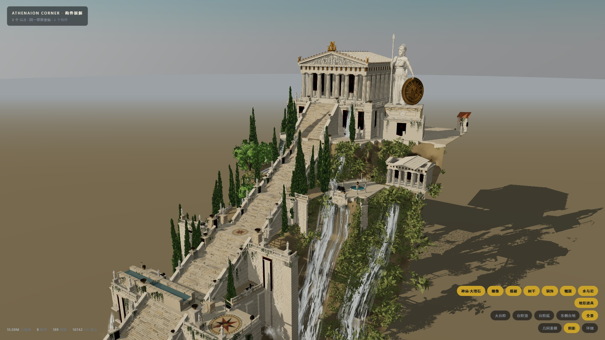
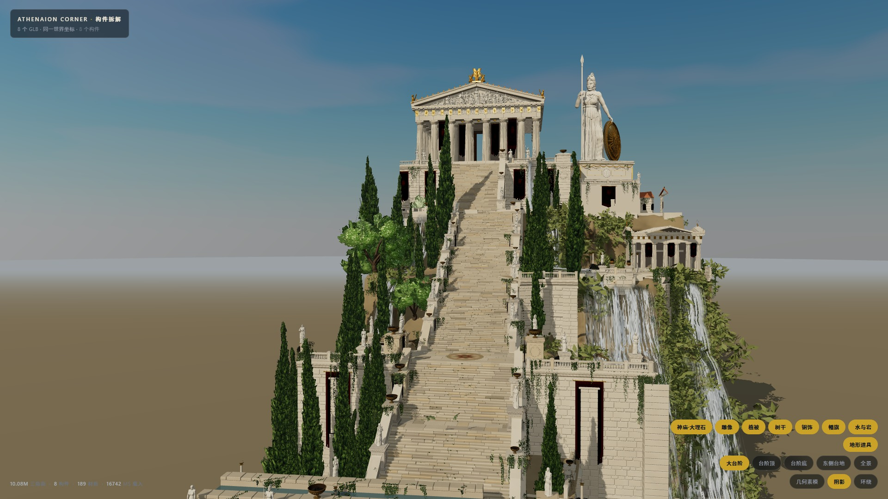
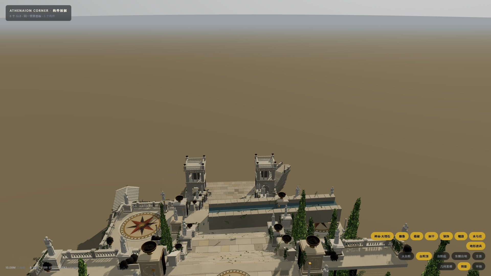
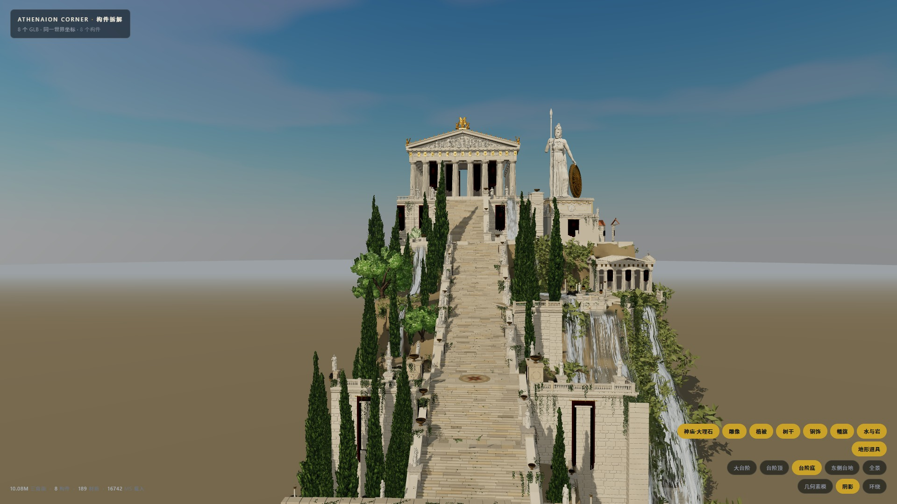
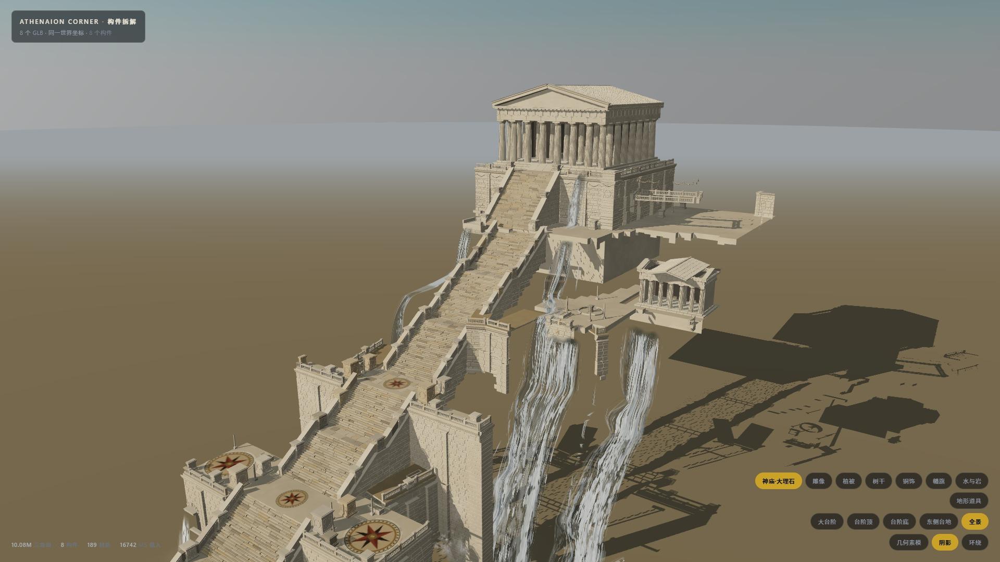
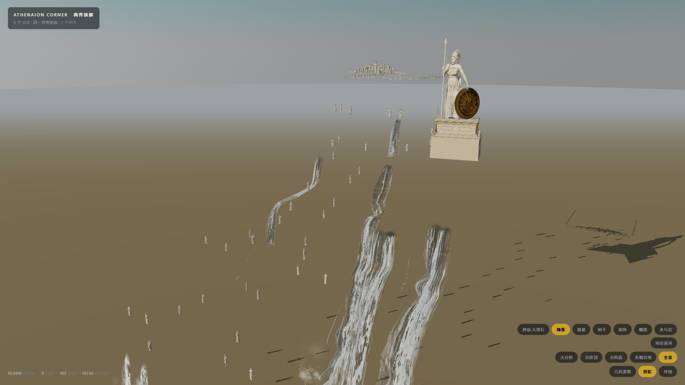
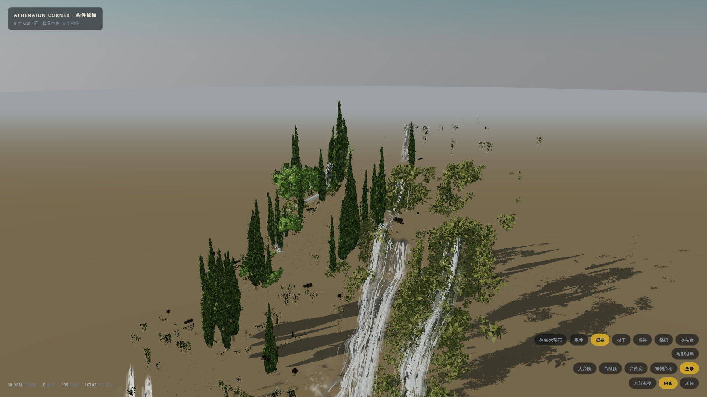
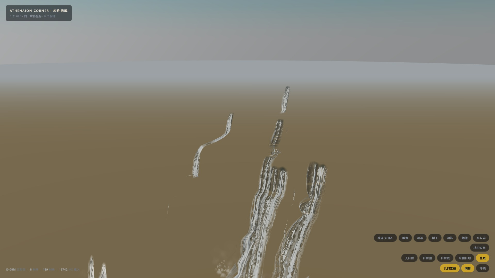

# Athenaion Corner · 卫城大台阶（8 个 GLB 构件）

把 **Athenaion** 项目里「卫城大台阶」这一角，按构件拆成 8 个 GLB，用同一个世界坐标烘焙，
可以整场景加载，也可以只拿其中一类（比如只要神庙本体、只要雕像）。附一个可直接跑的 three.js 查看器。



---

## 原项目

| | |
|---|---|
| 名称 | **Athenaion** |
| 它是什么 | 用 three.js 在浏览器里**纯代码生成**的古希腊卫城世界：神庙、大台阶、雕像、瀑布、森林、城市、大气与光照 |
| 素材 | **零外部美术资源**。每一个 mesh、贴图、shader、树、雕像、瀑布都是运行时代码算出来的，项目约 45,000 行 |
| 怎么来的 | 作者用 Claude Code（Opus 5.5）配合 55 个并行子代理，约两天完成，对照 9 张参考图迭代 |
| 许可 | MIT |

本仓库是它的**二次创作**：只取其中「卫城大台阶」这一角做场景切片与构件拆分，
瀑布的着色器直接复用原项目 `src/water/fallMesh.js`（未改动逻辑），
所有几何的世界坐标、比例、材质命名都与原项目一致。

> 说明：本仓库不包含原项目的完整世界，只包含这一角的导出结果与运行所需的少量源码。

## 这次复刻是怎么完成的

在 **TRAE** 中调用 **DeepSeek-V4.1-Flash**，累计消耗约 **150 积分**，完成从「读懂原项目」到「拆成 8 个模型 + 视频」的全过程：

1. **读懂场景**：定位原项目的场景图与材质命名体系（`marble-*`、`acro-*`、`statue*`、`foliage-*` 等）
2. **裁剪导出**：在运行时页面里按世界坐标盒**逐三角形裁剪**（跨边界三角形用 Sutherland–Hodgman 裁剪后扇形三角化），
   避免「整块模型搬进来」导致的越界与悬空
3. **补回丢失的着色器**：GLB 只带几何，原项目的程序化瀑布材质与每顶点的「到达时刻 τ」全部丢失。
   因此把瀑布几何与元数据**旁挂导出**成 `water/falls.bin` + `water/falls.json`，
   运行时用原版 `createFallMaterial()` 重新驱动，水面才会真正流动、加速、撕边
4. **水花**：落点数据（22 个落在裁剪盒内的瀑布落点）驱动四类实例化粒子（水雾 / 翻涌 / 飞溅水珠 / 落水白水），
   共约 1400 个实例，一次 draw call
5. **拆分**：按构件类别把 448 万个唯一三角面拆成 8 个 GLB，坐标原点统一
6. **出片**：逐帧确定性渲染（帧号驱动水体时间轴）+ ffmpeg 剪辑成 60 秒多角度视频

## 8 个构件

| 文件 | 大小 | 唯一三角面 | 内容 |
|---|---:|---:|---|
| `models/temple-marble.glb` | 40.85 MB | 599,745 | 神庙本体与台阶的大理石：柱、檐部、山花、踏步、铺地、马赛克 |
| `models/statues.glb` | 31.86 MB | 1,686,934 | 神像、女神与盾牌、装饰件、基座铭牌 |
| `models/foliage.glb` | 85.98 MB | 1,341,048 | 常春藤 / 橄榄叶 / 草 / 苔藓 / 灌木（大量实例化） |
| `models/trees.glb` | 7.60 MB | 212,268 | 柏树、橄榄树的树干 |
| `models/ornament.glb` | 12.60 MB | 399,683 | 金饰、铜火盆、铜瓮、金幡顶 |
| `models/banners.glb` | 4.52 MB | 124,741 | 幡旗织物 |
| `models/water-rock.glb` | 1.94 MB | 100,306 | 静态水片、河石、瀑布岩、水渠石 |
| `models/terrain-props.glb` | 0.45 MB | 20,351 | 地形、城郭、陶器、暗部填充 |

合计 **185.8 MB / 4,480,076 唯一三角面**；实例化后场景实际渲染 **10,076,142 三角面 / 189 个材质**。

所有 GLB 共用同一套世界坐标（直接 `scene.add()` 即可拼回），不需要任何额外变换。

## 运行

```bash
# 任意静态服务器都行，因为用了 ES module + fetch，不能直接双击 index.html
node serve.mjs 8124      # 或：python -m http.server 8124
# 打开 http://localhost:8124/
```

查看器里可以：
- 5 个预设机位（大台阶 / 台阶顶 / 台阶底 / 东侧台地 / 全景）
- **逐个开关 8 个构件**，验证它们确实是独立的模型
- 几何素模、阴影、环绕

## 目录

```
index.html              查看器（three.js，相对路径，可直接丢到任意 CDN 子目录）
serve.mjs               无依赖本地预览
models/*.glb            8 个构件
water/falls.bin         瀑布几何（含每顶点 τ，自定义 attribute）
water/falls.json        瀑布元数据：落点 impact / 跌落路径 / 网格布局
src/water/fallMesh.js   原项目瀑布网格 + 材质（复刻的核心）
src/core/               proceduralMaterial / GLSL 噪声 / hash
vendor/three/           three r186 + 用到的 addons（GLTFLoader / OrbitControls / Sky / RoomEnvironment）
shots/                  多角度与构件隔离截图
video/athenaion-corner.mp4   60 秒多角度成片
```

## 截图

| 全景 | 大台阶 |
|---|---|
|  |  |

| 台阶顶 | 低角度 |
|---|---|
|  |  |

构件隔离（只显示一类，证明 8 个 GLB 是拆开的）：

| 只有神庙大理石 | 只有雕像 | 只有植被 |
|---|---|---|
|  |  |  |

几何素模：



## 许可

- 本仓库的**代码**（查看器、拆分与导出脚本）：MIT
- 导出的 **GLB 几何**：来自原项目 Athenaion，遵循其 MIT 许可；二次分发请保留本段署名与出处说明
- 原项目作者与生成方式见上文「原项目」
